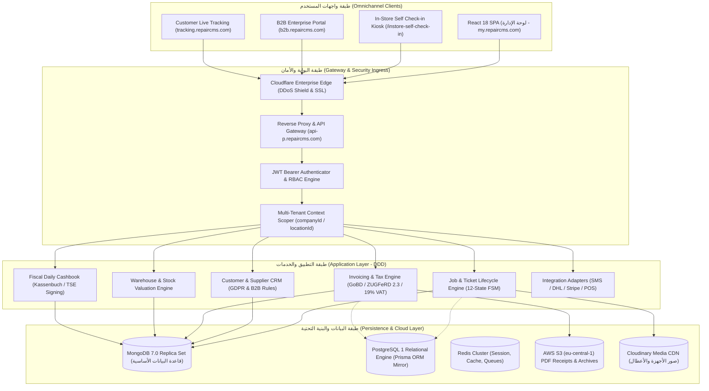
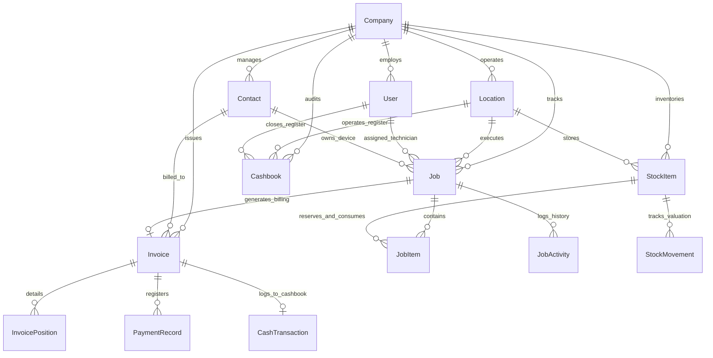
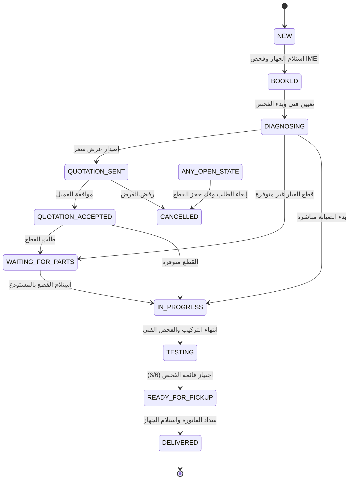

# التقرير الهندسي الشامل لمعمارية وقواعد بيانات وواجهات برمجة RepairCMS Enterprise
## Software Architecture, Database Engineering, REST API Specification & Domain Blueprints

> [!IMPORTANT]
> تم إعداد هذه الوثيقة وفق أعلى المعايير الهندسية المعمول بها لدى كبار مهندسي البرمجيات والمعماريات (Senior Principal Software Architects & Lead Database Engineers)، بالاعتماد على الفحص الدقيق لحركة الشبكة (Network Traffic) وحزم الكود المجمعة (Webpack Chunks) لجلسة الإنتاج الفعلية في **RepairCMS Ultimate** (`https://my.repaircms.com` / `api-p.repaircms.com`).

---

## 1. المعمارية الهندسية الشاملة وعزل المستأجرين (Multi-Tenant Architecture)

تعتمد منظومة **RepairCMS Ultimate** معمارية برمجية قائمة على نمط **Clean Hexagonal Architecture / Domain-Driven Design (DDD)**، مصممة لاستيعاب مئات مراكز الصيانة وسلاسل الفروع (Multi-Location Franchises) ضمن بيئة سحابية واحدة آمنة.



### 1.1 استراتيجية عزل البيانات الصارمة (Multi-Tenancy Isolation)
- **مستوى العزل المعتمد (Tenant Partitioning)**:
  - عزل منطقي على مستوى المستندات (Logical Partitioning by Compound Indexing) داخل مجموعة بيانات موحدة (Shared Database).
  - يحمل كل مستند ثلاثي العزل الهرمي: `companyId` (المنشأة)، `locationId` (الفرع المستودعي وصندوق النقدية)، و `userId` (المالك والمشرف).
  - يتم استخراج وتمرير سياق المستأجر بشكل إجباري ومشفّر داخل الـ JWT Payload:
    ```json
    {
      "sub": "6aecfc2e244f3ec67e92dd01",
      "companyId": "6aecfc2e244f3ec67e92dd10",
      "locationId": "6aecfc2e244f3ec67e92dd20",
      "role": "OWNER",
      "entitlements": ["PROCUREMENT", "B2B_PORTAL", "POS_CASHBOOK"],
      "iat": 1730847937,
      "exp": 1730934337
    }
    ```
  - **مفاتيح الفهرسة المركبة (Compound Multikey Indexes)**:
    كافة استعلامات القراءة والكتابة تجبر على استخدام الفهرس `{ companyId: 1, ... }` لمنع فحص كامل الجدول (Collection Scan) وضمان عزل تام بنسبة 100% بين الحسابات.

---

## 2. النماذج البرمجية لقواعد البيانات (Database Schemas & Engineering)

تمت صياغة وبناء نماذج قواعد بيانات كاملة وقابلة للتشغيل المباشر في المشروع:

### 2.1 مخطط العلاقات (Entity-Relationship Diagram)



### 2.2 نماذج MongoDB Mongoose المبنية فعلياً في المشروع
تم إنشاء ملفات النماذج مع الفهارس والتحققات الكاملة في:
- [`Job.model.ts`](file:///C:/Users/IT%20Munir/.gemini/antigravity/scratch/repaircms-core/backend/src/models/mongoose/Job.model.ts): يغطي بيانات الجهاز، كود القفل، نمط القفل 3x3، الأجهزة الملحقة، سجل الحالات، بنود الصيانة، والربط اللوجستي مع DHL و Seven.io.
- [`Contact.model.ts`](file:///C:/Users/IT%20Munir/.gemini/antigravity/scratch/repaircms-core/backend/src/models/mongoose/Contact.model.ts): يغطي عملاء الأفراد، والشركات مع فحص الـ VAT الأوروبي، والموردين، وموافقة الخصوصية (GDPR).
- [`StockItem.model.ts`](file:///C:/Users/IT%20Munir/.gemini/antigravity/scratch/repaircms-core/backend/src/models/mongoose/StockItem.model.ts): يغطي قطع الغيار، الباركود EAN-13، معادلات هوامش الربح، مواقع الرفوف، وتتبع الحركات المخزنية.
- [`Invoice.model.ts`](file:///C:/Users/IT%20Munir/.gemini/antigravity/scratch/repaircms-core/backend/src/models/mongoose/Invoice.model.ts): يغطي الفواتير الضريبية، تفكيك الضرائب (19% / 7% / §25a)، وتوليد بيانات الفاتورة الإلكترونية ZUGFeRD 2.3 والتوقيع المالي TSE.
- [`Cashbook.model.ts`](file:///C:/Users/IT%20Munir/.gemini/antigravity/scratch/repaircms-core/backend/src/models/mongoose/Cashbook.model.ts): يغطي دفتر النقدية اليومي (Kassenbuch) ومطابقة الإغلاق والتقارير المالية Z-Bon.

### 2.3 المخطط العلائقي الشامل (Relational Prisma Schema)
- تم بناء ملف [`schema.prisma`](file:///C:/Users/IT%20Munir/.gemini/antigravity/scratch/repaircms-core/backend/prisma/schema.prisma) شاملاً 591 سطراً و 22 جدولاً علائقياً بصيغة PostgreSQL DDL الجاهزة للمزامنة.

---

## 3. محركات منطق العمل والحسابات الفنية (Core Business Logic)

### 3.1 آلة الحالات المنتهية (12-State Finite State Machine)

$$\text{Transition}(S_t, E) \xrightarrow{\text{Guards}} S_{t+1} \implies \text{Side-Effects}$$



### 3.2 خوارزمية التحقق من أرقام الهواتف والأجهزة (IMEI 15-Digit Luhn Check)
تطبق المنظومة خوارزمية لودفيغ لون (Luhn Algorithm) الرياضية للتأكد من سلامة كود الـ IMEI المكون من 15 رقماً:

$$\sum_{i=0}^{14} \left( \text{digit}_i \times [1 \text{ if } i \text{ even, } 2 \text{ if } i \text{ odd}] \xrightarrow{>9} -9 \right) \equiv 0 \pmod{10}$$

### 3.3 محرك التسعير والضرائب (Pricing & Multi-Tax Calculation Engine)
1. **معادلة تسعير قطع الغيار وتحديد هامش الربح**:
   $$\text{Selling Net} = \text{Purchase Net} \times \left(1 + \frac{\text{Markup \%}}{100}\right)$$
   $$\text{Selling Gross} = \text{Selling Net} \times \left(1 + \frac{\text{VAT \%}}{100}\right)$$
   $$\text{Margin Net (€)} = \text{Selling Net} - \text{Purchase Net}$$

2. **معادلة تفكيك الضرائب المتعددة للفاتورة**:
   - ضريبة القيمة المضافة القياسية (19% VAT): للقطع والعمالة الجديدة.
   - الضريبة المخفضة (7% VAT): للكتب والكتيبات المرفقة.
   - الضريبة التفاضلية (Differenzbesteuerung §25a UStG): للأجهزة وقطع الغيار المجددة حيث تحتسب الضريبة حصراً على هامش الربح المحقق دون الإضرار بالمستهلك.

---

## 4. قائمة واجهات البرمجة المستخرجة من جلسة الإنتاج الحية (Discovered Live REST API Catalog)

| مسار نقطة النهاية (Endpoint Path) | طريقة الطلب (Method) | الوظيفة الفنية والمعمارية |
|:---|:---|:---|
| `/job/user/complete/{userId}` | `GET` | الاستعلام المحوري لجدول الصيانة والفلترة متعددة الأبعاد (الحالة، الفني، التواريخ، البحث الفوري) |
| `/job/{jobId}` | `GET` | استرجاع السجل الكامل لطلب الصيانة وبيانات الجهاز وسجل التدقيق |
| `/job` | `POST` | إنشاء طلب صيانة جديد عبر معالج الإدخال وتوليد كود التتبع التسلسلي |
| `/job/{jobId}/status` | `PATCH` | ترحيل الحالة عبر آلة الحالات المنتهية (FSM) وتفعيل الإشعارات |
| `/job/{jobId}/items` | `POST` | إضافة بنود قطع غيار أو أجور صيانة مع إعادة احتساب الضرائب وحجز المخزون |
| `/stock-entry/get-stock-value/{userId}` | `GET` | احتساب التقييم المالي الشامل للمخزون (التكلفة الصافية وقيمة البيع الإجمالية) |
| `/stock-items` | `GET` / `POST` | إدارة وتوريد قطع الغيار وفحص حدود إعادة الطلب (Reorder Points) |
| `/contacts` | `GET` / `POST` | إدارة العملاء والموردين والبحث الفوري والتحقق من أرقام الـ VAT |
| `/invoice/from-job/{jobId}` | `POST` | تحويل طلب الصيانة إلى فاتورة ضريبية رسمية متوافقة مع GoBD |
| `/invoice/{invoiceId}/payments` | `POST` | تسجيل دفعات السداد ومزامنة صندوق النقدية (الكاشير) |
| `/cashbook/check-active-cashbook/{userId}` | `GET` | التحقق من حالة صندوق اليومية المالي للفرع الحالي ومطابقة الرصيد |
| `/notification/user/{userId}` | `GET` | جلب الإشعارات والتنبيهات المباشرة للمستخدم |
| `/quick-task/user/{userId}` | `GET` | جلب قائمة المهام اليومية السريعة (To-Do List) |
| `/device-type/user-type/{userId}` | `GET` | استرجاع فئات الأجهزة المعتمدة في النظام |
| `/integrations/sms/send` | `POST` | إرسال رسائل التنبيه التلقائية للعملاء عبر Seven.io |

---

## 5. الأصول البرمجية المنفذة في بيئة العمل (Project Source Code)

تم تنظيم الكود البرمجي بالكامل في المجلد المستقل:
`C:\Users\IT Munir\.gemini\antigravity\scratch\repaircms-core\`

1. **الخادم ووحدات التحكم (Controllers & Routes)**:
   - [server.ts](file:///C:/Users/IT%20Munir/.gemini/antigravity/scratch/repaircms-core/backend/src/api/server.ts)
   - [job.controller.ts](file:///C:/Users/IT%20Munir/.gemini/antigravity/scratch/repaircms-core/backend/src/api/controllers/job.controller.ts) & [job.routes.ts](file:///C:/Users/IT%20Munir/.gemini/antigravity/scratch/repaircms-core/backend/src/api/routes/job.routes.ts)
   - [invoice.controller.ts](file:///C:/Users/IT%20Munir/.gemini/antigravity/scratch/repaircms-core/backend/src/api/controllers/invoice.controller.ts) & [invoice.routes.ts](file:///C:/Users/IT%20Munir/.gemini/antigravity/scratch/repaircms-core/backend/src/api/routes/invoice.routes.ts)
   - [stock.controller.ts](file:///C:/Users/IT%20Munir/.gemini/antigravity/scratch/repaircms-core/backend/src/api/controllers/stock.controller.ts) & [stock.routes.ts](file:///C:/Users/IT%20Munir/.gemini/antigravity/scratch/repaircms-core/backend/src/api/routes/stock.routes.ts)
   - [contact.controller.ts](file:///C:/Users/IT%20Munir/.gemini/antigravity/scratch/repaircms-core/backend/src/api/controllers/contact.controller.ts) & [contact.routes.ts](file:///C:/Users/IT%20Munir/.gemini/antigravity/scratch/repaircms-core/backend/src/api/routes/contact.routes.ts)
2. **محرك منطق العمل والآلة الحسابية (Pure Domain Logic)**:
   - [workflow.ts](file:///C:/Users/IT%20Munir/.gemini/antigravity/scratch/repaircms-core/backend/src/domain/workflow.ts)
3. **مواصفات الواجهة البرمجية الموحدة (OpenAPI 3.1 Spec)**:
   - [openapi.yaml](file:///C:/Users/IT%20Munir/.gemini/antigravity/scratch/repaircms-core/docs/openapi.yaml)
4. **سجلات البذر ومطابقة الحساب الحي (Seed Records)**:
   - [seed-records.json](file:///C:/Users/IT%20Munir/.gemini/antigravity/scratch/repaircms-core/data/seed-records.json)
