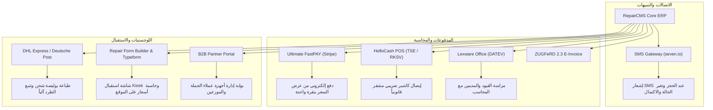

# المرجع التوثيقي والهندسي الشامل لتطبيق RepairCMS Ultimate

وثيقة تشغيلية وهندسية متكاملة لنظام إدارة مراكز وورش الصيانة السحابي **RepairCMS Ultimate**، تجمع بين المعمارية التقنية، لغة التصميم (UI/UX Design Tokens)، أدلة إدخال البيانات والنماذج التفاعلية، قواعد التحقق من صحة المدخلات (Validations)، آليات الفلاتر والبحث والفرز المتقدم، توثيق عناصر وقوائم الشريط العلوي على اليمين (Top-Right Bar)، والدليل العملي لربط كافة التكاملات والخدمات الخارجية (`Apps & Integrations`)، مدعمة بـ **61 لقطة شاشة عالية الدقة** تم التقاطها مباشرة من داخل النظام الفعلي.

---

## 1. المعمارية التقنية وبيانات الجلسة (System Context & Architecture)

- **اسم المنظومة**: RepairCMS Ultimate
- **التصنيف**: SaaS ERP & CRM سحابي مخصص لإدارة عمليات صيانة الأجهزة الإلكترونية والهواتف الذكية.
- **البنية التقنية (Tech Stack)**:
  - **Front-End**: تطبيق صفحة واحدة مبني بـ React SPA مع React Router لتأمين التنقل اللحظي وحفظ حالة الشاشات.
  - **Styling**: نظام شبكي Bootstrap 5 Grid مع حزمة موسعة من متغيرات التصميم المخصصة (`--rc-*` Design Tokens).
  - **Cloud Media**: Amazon Web Services S3 في منطقة فرانكفورت (`eu-central-1`) لتخزين ملفات الفحص والشعارات والوسائط.
  - **Analytics & Tracking**: مراقبة الجلسات عبر PostHog، والمساعدة التفاعلية الذكية عبر BetterDocs AI، ومنظومة جمع الملاحظات UserBack.
- **سياق الحساب المفحوص**:
  - **المتجر / الشركة**: Fix (برلين - Frankfurter Allee 53, 13357 Berlin, Germany).
  - **المستخدم الحالي**: mini laptop (الدور: مالك النظام - Owner).
  - **البريد الإلكتروني**: `daser46507@drtall.com`
  - **الخطة**: تجريبية كاملة المزايا (Trial Active - متبقي 14 يوماً حتى 19 نوفمبر 2026).
  - **المنطقة الزمنية والعملة**: أوروبا/برلين (GMT+2) والعملة الرسمية اليورو (€).

---

## 2. لغة التصميم ونظام واجهة المستخدم (UI/UX Design Tokens)

### 2.1 لوحة الألوان (Design Tokens)
- **اللون الأساسي للعلامة (Primary Brand Blue)**: `#2589f6` (عند التفاعل: `#1e7cd2`، الخلفيات الفاتحة: `#e5f2ff`، الظلال: `#2589f61a`).
- **خلفية الشريط الجانبي (Sidebar Dark Slate)**: `#343655`.
- **خلفية مساحة العمل العامة (App Canvas Background)**: `#f0f3f7`.
- **أسطح البطاقات والحاويات (Card Surfaces)**: `#ffffff` مع حواف مدورة بزاوية 8px وظلال مسطحة ناعمة.
- **ألوان النصوص والطباعة**:
  - العناوين الرئيسية: `#253053`
  - نصوص القراءة العادية: `#5b6b82` و `#575757`
  - الملاحظات والنصوص الخافتة: `#8b98aa` و `#b8bbc7`
  - الخطوط الفاصلة (Borders & Dividers): `#dee3e8` و `#e5eaf0`
- **شارات حالات النظام (Status Badges)**:
  - الأخضر (Success / Active / Delivered): `#22c55e` (الخلفية: `#dcfce7`)
  - الكهرماني/البرتقالي (Warning / Pending / Quotation): `#f5a623` (الخلفية: `#fbe7c9`)
  - الأحمر (Danger / Rejected / Missing): `#ff3b3b` (الخلفية: `#ff8a80`)
  - تدرج أزرار الترقية (Upgrade Action): `linear-gradient(98deg, #217efd 23.22%, #db00ff 106.96%)`
  - تدرج الهوية البصرية (Brand Accent): `linear-gradient(97deg, #2589f6 4.27%, #7c53ca 79.56%)`

---

## 3. التوثيق التشغيلي لعناصر وقوائم الشريط العلوي على اليمين (Top-Right Bar)

يضم الشريط العلوي على اليمين منظومة متكاملة من أدوات إدارة الجلسة، الحساب، الإجراءات السريعة، والثيمات، والتنبيهات:

### 3.1 بطاقة المستخدم والقائمة المنسدلة (User Profile Card & Dropdown)
- **ملف الشاشة**: `00_topbar_user_profile_dropdown.png`
- **عنصر التفعيل**: النقر على بطاقة المستخدم المصغرة في الزاوية العلوية اليمنى (التي تعرض صورة الأفاتار واسم المستخدم `mini laptop` وفرع المتجر `berlin`).
- **خيارات ومحتويات القائمة المنسدلة**:
  1. **رأس الحساب (User Account Header)**:
     - الصورة الرمزية للمستخدم (Avatar).
     - اسم الحساب النشط: `mini laptop`.
     - بريد المالك الإداري: `daser46507@drtall.com`.
  2. **بطاقة الاشتراك وترقية الخطة (Trial & Upgrade Banner)**:
     - شارة توضيحية: *14 Days Free Trial*.
     - العداد التنازلي الحي: *14 of 14 trial days remaining*.
     - زر الإجراء السريع: **Upgrade plan** (يوجه مباشرة لصفحة إدارة الاشتراكات والترقية `/subscription-management`).
  3. **روابط التنقل والإعدادات**:
     - **Profile** (`/profile`): الانتقال لإعدادات الملف الشخصي، اختيار لغة الواجهة، المنطقة الزمنية وتعديل كلمة المرور.
     - **Company Settings** (`/Company`): الانتقال إلى الإعدادات المؤسسية، بيانات المتجر، العنوان، الحسابات البنكية (IBAN/BIC) والأرقام الضريبية.
     - **Help** (`https://help.repaircms.com/`): فتح قاعدة المعرفة ومركز الدعم والمقالات الإرشادية في لسان مستقل.
     - **Release Notes** (`https://help.repaircms.com/releasenotes/`): استعراض سجل التحديثات والميزات الدورية للنظام في لسان مستقل.
     - **Sign out**: إنهاء الجلسة والخروج الآمن من المنظومة.
     - **Privacy Policy** (`https://repaircms.com/privacy-statement-eu/`): استعراض سياسة حماية الخصوصية ومطابقة لائحة GDPR الأوروبية.

---

### 3.2 نافذة العمليات والإجراءات السريعة (+ Quick Action Process Modal)
- **ملف الشاشة**: `00_topbar_quick_process_modal.png`
- **عنصر التفعيل**: الزر الدائري الأزرق البارز في الشريط العلوي الحامل لرمز علامة الزائد `+`.
- **نافذة "Select Your Process"**: نافذة مركزية منبثقة تتيح تشغيل 7 عمليات تشغيلية فورية دون الحاجة لمغادرة الشاشة الحالية أو البحث في القوائم الجانبية:
  1. **New Invoice**: فتح شاشة تحرير فاتورة جديدة فوراً (`/invoice/create-new`).
  2. **Service Pricing**: فتح دليل تسعير الخدمات وتكاليف العمالة بالساعة (`/service`).
  3. **Express Job**: إطلاق مسار الحجز السريع المخصص للعملاء المستعجلين لخدمات التبديل الفوري (شاشات وبطاريات).
  4. **New Job**: فتح معالج تسجيل أمر الصيانة القياسي المتكامل المكون من 5 خطوات.
  5. **New Item**: فتح درج إدخال قطعة غيار جديدة للمستودع وحساب هامش الربح والباركود.
  6. **New Contact**: فتح نافذة إضافة عميل جديد (فرد أو شركة أو مورد).
  7. **New Service**: فتح نموذج استحداث خدمة فنية جديدة وتسعيرها.

---

### 3.3 محدد الثيمات وتخصيص المظهر (Theme Selector Popover)
- **ملف الشاشة**: `00_topbar_theme_selector_popover.png`
- **عنصر التفعيل**: أيقونة لوحة الألوان المجاورة للبحث السريع في الشريط العلوي.
- **نافذة "Choose Your Theme"**: تتيح تخصيص الهوية اللونية للواجهة حسب رغبة المتجر من خلال:
  - **النمط الافتراضي (Default Theme)**: باليتة الألوان المعتمدة (الأزرق مع الرمادي الفاتح).
  - **8 باليتات مخصصة (Theme 0 حتى Theme 7)**: تتيح التبديل الفوري بين تدرجات ألوان شريط التنقل والبطاقات والأزرار بنقرة واحدة لتلائم أجهزة الورش أو الشاشات المعتمة.

---

### 3.4 مركز التنبيهات والإشعارات اللحظية (Notifications Bell Popover)
- **ملف الشاشة**: `00_topbar_notifications_popover.png`
- **عنصر التفعيل**: أيقونة الجرس 🔔 في الشريط العلوي.
- **النافذة المنبثقة**:
  - عرض قائمة التنبيهات اللحظية ومستجدات أوامر الصيانة.
  - حالة خلو التنبيهات (Empty State): إظهار رسالة توضيحية *"Notification Not Found"*.
  - رابط **Settings**: للانتقال المباشر لدرج التحكم الشامل في قنوات الإشعارات.

---

### 3.5 درج إعدادات الإشعارات المتقدم (Notification Settings Slide-over Drawer)
- **ملف الشاشة**: `00_topbar_notification_settings_drawer.png`
- **عنصر التفعيل**: النقر على رابط "Settings" في نافذة التنبيهات.
- **الوظائف والأقسام**: درج جانبي كامل ينزلق من اليمين يمنح المشرف تحكماً كاملاً بقنوات الإشعار المستقلة: **البريد الإلكتروني (Email)** و **التنبيهات اللحظية (Push Notifications)** عبر 4 مجموعات تشغيلية:
  1. **أنشطة أوامر الصيانة (Job Activities)**:
     - الإشارة للمستخدم في التعليقات (`@mentions me in any comments`) [Email: ON/OFF | Push: ON/OFF].
     - الرد على تعليقات المستخدم (`Someone respond to my comment`) [Email: ON/OFF | Push: ON/OFF].
  2. **أوامر الصيانة الخاصة بي (My Jobs - Assigned to or Followed by Me)**:
     - تعيين وظيفة لي أو إلغاء التعيين (`Someone assigns or unassigns me a job`) [Email: ON/OFF | Push: ON/OFF].
     - تغيير حالة الوظيفة أو أولويتها (`Someone changes job status and priority`) [Email: ON/OFF | Push: ON/OFF].
     - حلول موعد استحقاق الوظيفة (`When my assigned job is due`) [Email: ON/OFF | Push: ON/OFF].
     - كتابة تعليق على الوظيفة دون إشارة (`Someone comments without @mentioning me`) [Email: ON/OFF | Push: ON/OFF].
     - رسائل البريد التذكيرية للرسائل غير المقروءة (`Unread message reminder emails`) [Email: ON/OFF].
  3. **عروض الأسعار الخاصة بي (My Quotes)**:
     - قبول العميل لعرض السعر أو رفضه (`Someone accepts or decline my quotes`) [Email: ON/OFF | Push: ON/OFF].
     - رد العميل واستفساراته حول عرض السعر (`Someone respond to my quotes`) [Email: ON/OFF | Push: ON/OFF].
  4. **أنشطة النظام والمخزون (System Activities)**:
     - وصول قطع غيار معينة لحد الأمان/النفاذ في المخزون (`Certain stock items have hit their limits`) [Email: ON/OFF | Push: ON/OFF].
     - حلول موعد المهام اليومية المجدولة (`When my task is due`) [Email: ON/OFF | Push: ON/OFF].

````carousel

<!-- slide -->

<!-- slide -->

<!-- slide -->

<!-- slide -->

````

---

## 4. الدليل التشغيلي لإدخال البيانات وإكمال النماذج (Forms & Data Entry)

### 4.1 مسار إنشاء وتوثيق أمر الصيانة الجديد (`Add Job Flow`)
يمر إنشاء أمر الصيانة عبر 5 خطوات تفاعلية تضمن دقة توثيق الأعطال والمسؤولية القانونية:

1. **الخطوة 1: اختيار فئة ونوع الجهاز (Device Type)**:
   - شبكة أزرار مصورة تشمل 9 فئات أساسية:
     - Smart Phone (هاتف ذكي)
     - Notebook (حاسوب محمول)
     - Watch (ساعة ذكية)
     - Monitor (شاشات عرض)
     - Game Controller (أجهزة تحكم ألعاب)
     - Drone (طائرات مسيرة)
     - Coffee Machine (ماكينات قهوة)
     - E-Bike (دراجات كهربائية)
     - E-Scooter (سكوتر كهربائي)
   - *قاعدة التحقق*: إلزامي (لا يمكن الانتقال للخطوة التالية دون تحديد فئة).

2. **الخطوة 2: مواصفات الجهاز والحالة المادية (Device Details)**:
   - **الماركة والموديل (Brand & Model)\***: قائمة منسدلة ذكية بالماركات المعتمدة، مع إمكانية كتابة موديل غير مسجل يدوياً.
   - **الرقم التسلسلي أو الـ IMEI**:
     - للهواتف: حقل رقمي يقبل 15 خانة مع تدقيق حسابي (Luhn Algorithm).
     - للحواسيب والأجهزة الأخرى: يقبل أرقاماً تسلسلية أبجدية رقمية.
   - **حالة الجهاز الخارجية (Conditions)**: خيارات سريعة: *Like new (كالجديد)*، *Good (جيد)*، *Scratched (خدوش سطحية)*، *Heavily damaged (كسور بالغة)*، *Liquid damage (تعرض للسوائل)*.
   - **الملحقات المرفقة (Accessories Checklist)**: مربعات اختيار (Checkboxes) لتوثيق استلام: الشاحن (Power Adapter)، الكابل (Cable)، الحافظة (Case)، درج الشريحة (SIM Tray)، العلبة الأصلية (Box)، أو لا شيء (None).
   - **قفل الشاشة والحماية (Screen Lock Security)**:
     - التبديل بين:
       1. **رمز PIN الرقمي**: حقل مخصص لكتابة الأرقام.
       2. **نمط القفل الرسومي (Pattern Lock)**: شبكة تفاعلية 3x3 ترسم عليها الحركة بالفأرة أو اللمس لتسجيل نمط الفتح للفني.

3. **الخطوة 3: تحديد جهة الاتصال والعميل (Contact Details)**:
   - خيار البحث عن عميل مسجل مسبقاً، أو استخدام نموذج الإدخال السريع (Inline Quick Contact).
   - *الحقول الإلزامية*: الاسم الأول (First Name)\*، اسم العائلة (Last Name)\*، وأحد وسيلتي الاتصال على الأقل: رقم الجوال المسبوق بكود الدولة (+49)\* أو البريد الإلكتروني\*.
   - يظل زر المتابعة `Next` معطلاً (Disabled) برمجياً حتى مطابقة شروط التحقق.

4. **الخطوة 4: بيانات العطل والتكلفة (Job Details)**:
   - **نوع الصيانة (Job Type)\***: صيانة عامة (Repair)، صيانة دورية (Maintenance)، فحص تشخيصي (Inspection)، أو ضمان (Warranty).
   - **التكلفة التقديرية (Estimated Costs)**: قيمة مالية تقديرية مع خيار تسجيل دفعة مقدمة (Deposit).
   - **الأعراض ووصف العطل (Symptoms & Problem Description)\***: حقول نصية تفصيلية تدعم إدراج القوالب الجاهزة (`Snippets`).
   - **الملاحظات الداخلية (Internal Notes)**: نصوص مخصصة للفنيين لا تظهر للعميل نهائياً في الإيصالات أو البوابة.

5. **الخطوة 5: حجز وتخصيص قطع الغيار (Add Stock Items)**:
   - البحث في المستودع وربط القطع المطلوبة بالطلب لخصمها فورياً من الرصيد أو تخطي الخطوة لبدء الفحص.

````carousel

<!-- slide -->

<!-- slide -->

<!-- slide -->

````

---

### 4.2 مسار إنشاء الفاتورة وتسجيل طرق الدفع (`Invoices & Payments`)
- **بناء الفاتورة**:
  1. استدعاء العميل عبر البحث اللحظي.
  2. إضافة بنود متعددة (Positions): استيراد صنف من المخزون، أو خدمة فنية من الدليل، أو بند مخصص يدوي.
  3. تحديد الكمية، السعر الفردي، ونسبة الخصم (Discount %).
  4. تحديد معدل الضريبة لكل بند (19% القياسية، 7% المخفضة، أو 0% معفاة/Reverse Charge).
  5. محرك الاحتساب التلقائي اللحظي:
     $$\text{صافي البند} = (\text{السعر} \times \text{الكمية}) - \text{قيمة الخصم}$$
     $$\text{قيمة الضريبة} = \text{صافي البند} \times \frac{\text{نسبة الضريبة}}{100}$$
     $$\text{الإجمالي النهائي} = \text{إجمالي الصافي} + \text{إجمالي الضريبة}$$
- **نافذة تسجيل وسيلة الدفع (Payment Method Modal)**:
  عند الضغط على `Create Invoice` تتاح 5 مسارات تحصيل مالية:
  1. **POS - Cash**: استلام نقدي عند الكاونتر مع تسجيل في الدفتر النقدي.
  2. **POS - EC Card**: دفع ببطاقة مدى / الخصم المباشر (EC/Debit Card).
  3. **POS - Credit Card**: دفع ببطاقة الائتمان عبر جهاز نقاط البيع الفعلي.
  4. **Purchase On Account - Bank Transfer**: بيع آجل عبر فاتورة تحويل بنكي مع تعيين مهلة السداد (مثلاً 14 يوماً).
  5. **Online Method - Online Payment**: توليد رابط دفع سحابي فوري وإرساله للعميل بالبريد/SMS (عبر Stripe أو FastPAY).

````carousel

<!-- slide -->

<!-- slide -->

````

---

### 4.3 مصفوفة مقارنة أنواع جهات الاتصال (CRM: Personal vs Business vs Supplier)

| الحقل / المتطلب | الأفراد (Personal) | الشركات (Business) | الموردون (Supplier) |
|:---|:---:|:---:|:---:|
| **الحقل الإلزامي الأساسي** | First Name\* & Last Name | Company Name\* & E-Mail\* | Supplier Name\* |
| **مسؤول الاتصال (Contact Person)** | هو العميل نفسه | Salutation, Name\*, Position | Salutation, Name\*, Position |
| **الرقم الضريبي (VAT ID)** | غير متاح | حقل مخصص (VAT ID)\* | حقل مخصص (VAT ID) |
| **بيانات الفاتورة الإلكترونية** | غير متوفر | متاح (Leitweg-ID / Peppol)\* | غير متوفر |
| **شروط الدفع (Payment Terms)** | فوري عند الاستلام | قائمة منسدلة (7, 14, 30, 60 يوماً)\* | مرتبطة بحساب المشتريات |
| **تعدد العناوين** | عنوان أساسي | عناوين متعددة للشحن والفوترة | عنوان المستودع والمقر |

````carousel

<!-- slide -->

<!-- slide -->

````

---

### 4.4 حاسبة تسعير قطع المخزون وهوامش الربح والباركود (Stock Pricing & Barcode)
- **آلية عمل حاسبة هوامش الربح المدمجة (Pricing Markup Engine)**:
  عند تفعيل مفتاح *"Calculate your price with included profit markup"*:
  1. يدخل المستخدم **سعر الشراء الصافي (Purchase Price excl. VAT)**.
  2. يدخل **نسبة هامش الربح المطلوبة (Profit Markup %)**.
  3. يقوم النظام تلقائياً بحساب **سعر البيع الصافي (Net Price excl. VAT)**:
     $$\text{Net Price} = \text{Purchase Price} \times (1 + \frac{\text{Markup \%}}{100})$$
  4. تُحسب ضريبة القيمة المضافة (19% VAT) آلياً.
  5. يُعرض **السعر النهائي للمستهلك شاملاً الضريبة (Total Price incl. VAT)** في حقل مقروء فقط لمنع أخطاء الحساب اليدوي.
- **توليد وربط الباركود والأرقام التسلسلية**:
  - الضغط على `Add Barcode` يفتح حقلاً مخصصاً لإدخال أو مسح الباركود عبر الماسح الضوئي (EAN-13, Code 128) لتمكين الجرد السريع.
  - إمكانية إضافة أرقام القطع الأصلية (OEM Numbers) وأكواد SKU المخصصة.


---

## 5. الفلاتر والبحث والفرز المتقدم (Advanced Filters & Search)

### 5.1 فلاتر أوامر الصيانة (Job Pipeline & Popover Filters)
1. **فلتر مسار الحالات (Status Pipeline Tabs)**:
   - `All Jobs (1)` | `Repair in Progress (0)` | `Quotation (0)` | `Parts not available (0)` | `Ready To Return (0)` | `Missing parts ordered (0)` | `Parts delivered (0)` | `Archive`.
2. **فلتر الفني المسؤول (Assignee Popover)**:
   - نافذة منبثقة تتضمن شريط بحث فوري عن الموظفين، وخيارات تصفية سريعة: *All (الكل)*، *mini laptop (الفني المحدد)*، أو *Unassigned (الأجهزة غير المعينة لفني)*.
3. **فلتر الأولوية وتاريخ الاستحقاق (Priority & Due Date Popover)**:
   - تصنيف حسب درجة الأهمية: Urgent, High, Neutral, Low.
   - تحديد تاريخ الاستحقاق المطلوب (Due Date) مع أزرار `Clear Filter` و `Apply`.
4. **منتقي النطاق الزمني بالتقويم المزدوج (Dual-Month Calendar Range Picker)**:
   - تقويم تفاعلي يعرض شهرين متتاليين لاختيار تاريخ البداية والنهاية بسهولة.
5. **محرك البحث اللحظي الميداني (Real-time Instant Search)**:
   - يبحث فورياً أثناء الكتابة برقم الوظيفة (`Job ID`)، اسم العميل، رقم الهاتف، الموديل، السيريال، أو رقم الـ IMEI المكون من 15 خانة.
6. **قائمة التصدير (Export Menu)**:
   - تصدير فوري إلى **Export to CSV** أو **Export to Excel** مع تنسيق الجداول والتواريخ.

````carousel

<!-- slide -->

<!-- slide -->

<!-- slide -->

````

---

## 6. الدليل التشغيلي للتكاملات والتطبيقات الخارجية (Apps & Integrations Deep-Dive)

يوفر مسار `/integrations` بوابة ربط مركزية بكافة الخدمات السحابية. فيما يلي الخطوات والمفاتيح البرمجية المطلوبة لربط كل تطبيق:



---

### 6.1 مزود الرسائل النصية القصيرة SMS (seven.io)
- **ملف الشاشة**: `08_integration_seven_io_sms_setup.png`
- **متطلبات الربط**:
  - حساب لدى المزود الألماني Seven.io.
  - مفتاح **API Key** من قسم المطورين (`Developer area -> API`) بصلاحية `SMS Permission` وبيئة `Live`.
  - اسم مرسل نصي (**Alphanumeric Sender ID**) يصل إلى 11 حرفاً (مثل: `FixBerlin`).
  - تفعيل مربع الموافقة القانونية لامتثال GDPR: *"I confirm my customers have agreed to receive SMS from my business"*.
- **الأحداث والمشغلات المؤتمتة (Triggers)**:
  - *تأكيد أمر الصيانة*: رسالة ترحيبية فورية برقم الطلب ورابط التتبع.
  - *تغيير الحالة*: تنبيه آلي فور انتقال الجهاز إلى حالة فحص، أو بانتظار قطع، أو بدء الصيانة.
  - *اكتمال الإصلاح*: تنبيه العميل بجاهزية جهازه للاستلام والمبلغ المستحق.
  - *المراسلة المباشرة*: إرسال رسائل فردية للعميل من نافذة التواصل في أمر الصيانة.


---

### 6.2 بوابة الدفع الإلكتروني السريع (Ultimate FastPAY via Stripe)
- **ملف الشاشة**: `08_integration_fastpay_modal.png`
- **آلية الربط**:
  - النقر على `Activate` ثم `Enable Ultimate FastPAY`.
  - تحويل فوري لتدفق Stripe Connect Onboarding لربط حساب البنك (IBAN/BIC) ومطابقة الهوية (KYC).
- **الرسوم التشغيلية**:
  - رسوم Stripe القياسية + **0.25 €** ثابتة لكل معاملة ناجحة.
- **طريقة العمل**:
  - توليد أزرار دفع تفاعلية تلقائية داخل عروض الأسعار والفواتير المرسلة للعميل.
  - دعم أكثر من 30 وسيلة دفع تشمل: Visa, Mastercard, Apple Pay, Google Pay, Klarna.
  - تحويل حالة الفاتورة تلقائياً إلى "Paid" فور نجاح التحصيل دون تدخل بشري.


---

### 6.3 نظام نقاط البيع وصندوق الكاشير الضريبي (HelloCash POS)
- **ملف الشاشة**: `08_integration_hellocash_setup.png`
- **معالج الربط المكون من 3 خطوات**:
  1. **الخطوة 1 - الاتصال**:
     - اختيار الدولة: ألمانيا 🇩🇪 (`hellocash.de` لمطابقة وحدة التوقيع الرقمي TSE وقانون KassenSichV) أو النمسا 🇦🇹 (`hellocash.at` لمطابقة تشريعات RKSV) أو سويسرا 🇨🇭.
     - توليد وإدخال رمز **API Token** من إعدادات HelloCash (`Settings -> General -> helloCash API`).
  2. **الخطوة 2 - مطابقة الكاشير**: تعيين الفنيين والكاشير على صناديق HelloCash.
  3. **الخطوة 3 - الإطلاق الحي**: تفعيل التوقيع المالي الإلكتروني.
- **طريقة العمل**:
  - ترحيل كل دفعة نقدية أو بالبطاقة فورياً لدفتر الصندوق (Cash Book)، وطباعة إيصال مالي معتمد مع رمز QR كود الضريبي.
  - إلغاء الفاتورة في RepairCMS ينفذ عملية استرداد ملغاة (Storno) فورية في HelloCash.


---

### 6.4 المحاسبة السحابية والمزامنة مع مكاتب التدقيق (Lexware Office)
- **ملف الشاشة**: `08_integration_lexware.png`
- **طريقة الربط**:
  - النقر على `Connect` للتوجه إلى صفحة توثيق OAuth2 الرسمية لدى Lexware (`app.lexware.de/sign-in/authenticate`).
- **المزامنة الآلية**:
  - ترحيل الفواتير الصادرة وسندات القبض وحسابات المدينين آلياً.
  - تصدير بيانات الضرائب والمبيعات بصيغة متوافقة مع نظام مكاتب المحاسبة الألمانية (DATEV Export).


---

### 6.5 الشحن واللوجستيات السريعة (Repair Logistics - DHL Express)
- **ملف الشاشة**: `08_integration_repair_logistics_dhl.png`
- **طريقة الربط**:
  - ربط حساب بوابة أعمال دي إتش إل (DHL Geschäftskundenportal - GKP).
  - إدخال **رقم حساب العميل EKP (EKP Customer Number)** (10 إلى 14 خانة)، واسم مستخدم الـ API وكلمة المرور.
- **المزايا التشغيلية**:
  - طباعة بوليصة شحن DHL بنقرة زر واحدة (1-Click Label Generation) من تذكرة الصيانة.
  - دعم الدفع عند الاستلام (Nachnahme / Cash on Delivery)، والتأمين الإضافي.
  - المزامنة التلقائية لرقم التتبع (Tracking Number) داخل تذكرة الصيانة وبوابة العميل.


---

### 6.6 منشئ نماذج الصيانة التفاعلية واستقبال العملاء (Repair Form Builder & Typeform)
- **ملفات الشاشات**: `08_integration_repair_form_builder.png` و `08_app_typeform.png`
- **الأوضاع التشغيلية الأربعة المدمجة في Repair Form Builder**:
  1. **Repair Leads**: حاسبة أسعار فورية واستمارة حجز لأعطال الأجهزة تُدمج في موقع المتجر.
  2. **Kiosk Mode**: واجهة تسجيل ذاتي مخصصة لأجهزة التابلت في صالة الاستقبال بالمتجر.
  3. **Service Agent**: واجهة استلام تفصيلية للفنيين وموظفي الاستقبال.
  4. **RMA & Warranty**: نموذج مخصص لإدارة مطالبات الضمان والاستبدال لشركاء الأعمال.
- **تكامل Typeform**: ربط عبر بروتوكول OAuth2 لاستيراد الاستبيانات وتحويلها تلقائياً إلى أوامر صيانة في النظام.

````carousel

<!-- slide -->

````

---

### 6.7 الفاتورة الإلكترونية الألمانية وبوابة شركاء B2B
- **ملفات الشاشات**: `08_integration_e_invoice.png` و `08_integration_b2b_portal.png`
- **الفاتورة الإلكترونية ZUGFeRD 2.3**: إصدار ملفات PDF تتضمن ملف XML مهيكل متوافق بالكامل مع مواصفات EN 16931 الإلزامية في التعاملات الحكومية والتجارية مع دعم معرّف التوجيه الرسمي (Leitweg-ID).
- **بوابة الشركاء B2B**: واجهة مخصصة للشركات والمؤسسات التي ترسل دفعات أجهزة دورية لمتابعة حالة كل جهاز وتنزيل الفواتير المجمعة.

````carousel

<!-- slide -->

````

---

## 7. جدول ملفات لقطات الشاشة المحدثة بالكامل (61 لقطة شاشة)

جميع ملفات الصور محفوظة محلياً بجودة أصلية داخل المسار:
`C:\Users\IT Munir\.gemini\antigravity\brain\efcc0992-85c2-4f92-8b3b-8c110d3428e2\screenshots\`

| # | اسم الملف | الوصف ومحتوى الشاشة |
|:---:|:---|:---|
| 1 | `00_topbar_user_profile_dropdown.png` | القائمة المنسدلة لبطاقة المستخدم (mini laptop)، بيانات الحساب، التجربة المجانية، وروابط البروفايل، المتجر، المساعدة وتسجيل الخروج |
| 2 | `00_topbar_quick_process_modal.png` | نافذة "Select Your Process" للإطلاق السريع لـ 7 عمليات (فاتورة، صيانة، حجز سريع، عميل، صنف مخزني، خدمة) |
| 3 | `00_topbar_theme_selector_popover.png` | نافذة منتقي الثيمات "Choose Your Theme" والباليتات الثمانية لتخصيص الواجهة |
| 4 | `00_topbar_notifications_popover.png` | نافذة التنبيهات السريعة وحالة عدم وجود إشعارات وزر الانتقال للإعدادات |
| 5 | `00_topbar_notification_settings_drawer.png` | درج إعدادات التنبيهات المتقدم والتحكم المستقل بإشعارات Email و Push لـ 4 فئات تشغيلية |
| 6 | `01_dashboard.png` | لوحة القيادة، المؤشرات المالية، المهام ومسار العمليات |
| 7 | `02_jobs_overview.png` | جدول إدارة أوامر الصيانة ومسار الحالات |
| 8 | `02_jobs_add_device_type_modal.png` | الخطوة 1: اختيار فئة الجهاز (هاتف، لابتوب، ساعة...) |
| 9 | `02_jobs_add_device_details_step2.png` | الخطوة 2: مواصفات وموديل الجهاز، نمط القفل، والملحقات |
| 10 | `02_job_add_step3_contact.png` | الخطوة 3: تحديد والتحقق من بيانات العميل والإدخال السريع |
| 11 | `02_job_add_step4_job_details.png` | الخطوة 4: نوع الصيانة، الأعراض، الملاحظات الداخلية والتكلفة |
| 12 | `02_job_details.png` | مركز التحكم بطلب الصيانة وتعيين الفني والملاحظات الداخلية |
| 13 | `02_job_receipt_tab.png` | معاينة إيصال الاستلام الرسمي وشروط الضمان وتوقيع العميل |
| 14 | `02_job_quotation_tab.png` | إنشاء وتعديل عروض الأسعار وحساب الضرائب والخصومات |
| 15 | `02_job_invoice_tab.png` | ربط وتوليد الفواتير المحاسبية المرتبطة بأمر الصيانة |
| 16 | `02_job_service_report_tab.png` | محرر تقارير الفحص والخدمة الفنية للأجهزة |
| 17 | `02_jobs_filter_assignee_popover.png` | نافذة تصفية أوامر الصيانة حسب الفني المسؤول |
| 18 | `02_jobs_filter_priority_due_date_popover.png` | نافذة تصفية الوظائف حسب درجة الأولوية وتاريخ الاستحقاق |
| 19 | `02_jobs_filter_date_range_calendar.png` | منتقي النطاق الزمني بالتقويم التفاعلي المزدوج |
| 20 | `02_jobs_export_menu.png` | قائمة خيارات تصدير البيانات إلى Excel و CSV |
| 21 | `03_contacts.png` | جدول جهات الاتصال والعملاء وخيارات التصدير |
| 22 | `03_contacts_add_modal.png` | إضافة جهة اتصال شخصية (Personal) |
| 23 | `03_contact_add_business_form.png` | إضافة جهة اتصال تجارية للشركات (Business) مع الـ VAT |
| 24 | `03_contact_add_supplier_form.png` | إضافة مورد جديد لقطع الغيار (Supplier) |
| 25 | `03_contact_details.png` | ملف العميل الشامل (Customer 360) وتاريخ عملياته |
| 26 | `04_stock_items.png` | جدول المخزون وقطع الغيار والتنبيهات المسبقة |
| 27 | `04_stock_add_item_modal.png` | إضافة قطعة غيار جديدة مع إدخال البيانات التعريفية |
| 28 | `04_stock_add_item_calculator_open.png` | حاسبة هوامش الربح والضريبة وتوليد الباركود |
| 29 | `04_stock_goods_reception.png` | شاشة استلام البضائع وتوريدات الشحنات الجديدة |
| 30 | `05_services.png` | دليل الخدمات وتكاليف العمالة والربحية |
| 31 | `05_services_add_modal.png` | إضافة خدمة فنية جديدة مع تسعير ساعات العمل |
| 32 | `06_invoices.png` | سجل الفواتير والمستحقات وحالات السداد |
| 33 | `06_invoice_create_new.png` | إنشاء فاتورة جديدة والتبديل بين الصافي والإجمالي |
| 34 | `06_invoice_payment_method_modal.png` | نافذة تحديد وسيلة الدفع (نقدي، بطاقة، آجل، إلكتروني) |
| 35 | `07_repair_tracking.png` | إعدادات ومحرر بوابة تتبع الصيانة للعملاء |
| 36 | `08_apps_and_integrations.png` | متجر التكاملات والتطبيقات الخارجية والربط البرمجي |
| 37 | `08_app_typeform.png` | تكامل نماذج الاستلام والاستمارات الذكية Typeform |
| 38 | `08_integration_fastpay_modal.png` | تفعيل بوابة الدفع الإلكتروني السريع Ultimate FastPAY مع Stripe |
| 39 | `08_integration_hellocash_setup.png` | معالج ربط نقطة البيع الضريبية HelloCash POS (RKSV / TSE) |
| 40 | `08_integration_seven_io_sms_setup.png` | نافذة ربط وتوثيق مزود الرسائل النصية القصيرة seven.io |
| 41 | `08_integration_lexware.png` | صفحة تكامل Lexware Office للمحاسبة والمزامنة مع DATEV |
| 42 | `08_integration_repair_logistics_dhl.png` | إعدادات الشحن السريع مع DHL وإدخال حساب EKP |
| 43 | `08_integration_e_invoice.png` | تفاصيل الفاتورة الإلكترونية ZUGFeRD 2.3 والمتطلبات القانونية |
| 44 | `08_integration_b2b_portal.png` | بوابة الشركاء وموزعي الأجهزة B2B |
| 45 | `08_integration_repair_form_builder.png` | منشئ نماذج الصيانة وخيارات Kiosk و Leads و RMA |
| 46 | `09_settings_receipts.png` | قوالب الإيصالات والمستندات الرسمية |
| 47 | `09_settings_receipt_numbering.png` | إعدادات الترقيم التسلسلي التلقائي للمستندات |
| 48 | `09_settings_labels.png` | تخصيص وتصميم ملصقات الباركود والـ QR الحرارية |
| 49 | `09_settings_snippets.png` | قائمة النصوص السريعة المجهزة مسبقاً |
| 50 | `09_settings_snippets_add_modal.png` | نافذة إضافة نص سريع للرسائل والملاحظات |
| 51 | `09_settings_templates.png` | محرر قوالب البريد الإلكتروني والرسائل القصيرة |
| 52 | `09_settings_status.png` | مصفوفة حالات مسار الصيانة ومسار العمليات |
| 53 | `09_settings_brand_models.png` | دليل العلامات التجارية وموديلات الأجهزة الإلكترونية |
| 54 | `10_my_repaircms_profile.png` | الملف الشخصي للمستخدم واللغات والتوقيت والمنطقة الزمنية |
| 55 | `10_my_repaircms_company.png` | ملف المنشأة وساعات العمل والحسابات البنكية والضريبية |
| 56 | `10_my_repaircms_team_members.png` | إدارة فريق العمل والفنيين وتعيين الأدوار |
| 57 | `10_invite_team_members_modal.png` | نافذة دعوة أعضاء جدد عبر البريد الإلكتروني |
| 58 | `10_my_repaircms_subscription.png` | صفحة تفاصيل الخطة الحالية والتجربة المجانية |
| 59 | `10_my_repaircms_subscription_plans_modal.png` | جدول مقارنة كافة خطط وباقات الأسعار والمزايا |
| 60 | `10_my_repaircms_locations.png` | إدارة الفروع والمواقع الجغرافية لورش الصيانة |
| 61 | `10_plan_limit_modal.png` | نافذة التنبيه بضرورة الترقية عند تجاوز سعة الخطة |
