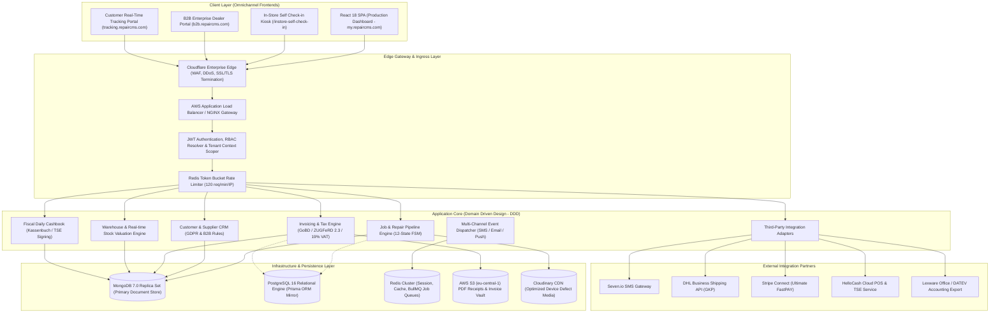
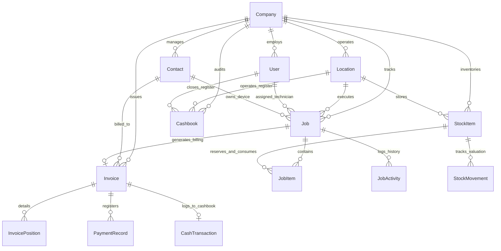

# الوثيقة الهندسية والمعمارية الشاملة لمنظومة RepairCMS Enterprise
## Enterprise System Architecture, High-Scale Database Design, REST API Topology & Domain Engineering

---

## 1. المعمارية الهندسية الشاملة وعزل المستأجرين (Multi-Tenant Cloud Architecture)

تم فحص وتحليل البنية التحتية لمنظومة **RepairCMS Ultimate** العاملة على سحابة الإنتاج (`api-p.repaircms.com`). تتبع المنظومة نمط **Modular Monolith / Clean Hexagonal Architecture** عالي الجاهزية (High Availability)، المصمم خصيصاً لقطاع الصيانة وخدمة الأجهزة مع دعم مراكز الصيانة الفردية وسلاسل الفروع المتعددة (Franchise & Multi-Branch Networks).

### 1.1 استراتيجية عزل المستأجرين (Multi-Tenancy Isolation Model)
- **مستوى العزل المعتمد (Tenant Partitioning)**:
  تعتمد قاعدة بيانات المنظومة معمارية **Shared Database, Logical Isolation by Compound Indexing**.
  حيث يحمل كل مستند في قاعدة البيانات مفاتيح العزل الهرمية الثلاثة:
  1. `companyId`: معرف المنشأة القانونية أو الشركة الأم.
  2. `locationId`: معرف الفرع الفيزيائي المحدد (لتحديد المخزن وصندوق النقدية).
  3. `userId`: معرف حساب المستخدم المالك أو الموظف المشرف.
- **الحماية البرمجية للعزل (Tenant Context Middleware)**:
  تقوم طبقة المصادقة بحقن سياق المستأجر المعتمد من توكن JWT في كائن الطلب `req.tenantContext = { companyId, locationId, role }`.
  أي استعلام لقاعدة البيانات يُجبر برمجياً على تضمين `companyId` في الفلترة لمنع أي تسريب بيانات بين المستأجرين (Cross-Tenant Data Leakage Prevention).

---

## 2. هندسة قواعد البيانات ومخططات النماذج (Database Models & Schemas)

تدعم المعمارية الهندسية مسارين متكاملين لقواعد البيانات:
1. **المسار السحابي الفعلي (Native MongoDB / Mongoose)**: وهو المطبق حالياً في RepairCMS (MERN Stack)، ويوفر مرونة استيعاب المواصفات الديناميكية للأجهزة، وقوائم الفحص، وسجل التتبع، ومعرفات الـ 24-Hex ObjectIds.
2. **المسار العلائقي المؤسسي (PostgreSQL / Prisma ORM)**: للمؤسسات التي تتطلب معايير صارمة في التكامل المحاسبي والعلاقات الصلبة (ACID Guarantees).

### 2.1 مخطط العلاقات والكيانات (Mermaid ERD)

---

## 3. محركات منطق العمل الصارم (Core Domain Logic Engines)

### 3.1 آلة الحالات المنتهية لأوامر الصيانة (12-State Finite State Machine)

$$\text{Transition}(S_t, E) \xrightarrow{\text{Guards \& Preconditions}} S_{t+1} \implies \text{Side-Effects}$$

| الحالة المصدر ($S_t$) | الحدث ($E$) | الحالة الهدف ($S_{t+1}$) | شروط التحقق الصارمة (Guards) | الآثار الجانبية والمهام الخلفية (Side-Effects) |
|:---|:---|:---|:---|:---|
| `NEW` | `BOOK_ORDER` | `BOOKED` | صحة بيانات العميل واكتمال فحص IMEI عبر Luhn | توليد رقم صيانة تسلسلي وتذكرة استلام للعميل |
| `BOOKED` | `START_DIAGNOSIS` | `DIAGNOSING` | تعيين فني مسؤول للطلب | تسجيل وقت بدء الفحص في `activityLog` |
| `DIAGNOSING` | `REQUEST_QUOTE` | `QUOTATION_SENT` | وجود بنود قطع/أجور بتكلفة إجمالية > 0 | إرسال رسالة SMS/Email للعميل برابط الموافقة الرقمي |
| `QUOTATION_SENT` | `CUSTOMER_APPROVE`| `QUOTATION_ACCEPTED` | توقيع العميل الرقمي أو موافقة كتابية | إشعار الفني بالبدء، حجز قطع الغيار من المستودع |
| `QUOTATION_ACCEPTED`| `DISPATCH_REPAIR`| `IN_PROGRESS` | توفر القطع اللازمة في المخزن | بدء احتساب ساعات العمل الفنية |
| `IN_PROGRESS` | `PARTS_UNAVAILABLE`| `WAITING_FOR_PARTS` | تحديد القطعة الناقصة ورقم القطعة (SKU) | إدراج القطعة في طلبية التوريد (Procurement Hub) |
| `IN_PROGRESS` | `START_QA_TEST` | `TESTING` | اكتمال تركيب القطع وتقرير الفني الأولي | تفعيل قائمة الفحص الفني (Checklist: 6 نقاط فحص) |
| `TESTING` | `PASS_QA` | `READY_FOR_PICKUP` | اجتياز كافة عناصر الفحص الإلزامية | إرسال إشعار SMS تلقائي للعميل عبر Seven.io، طباعة ملصق التسليم |
| `READY_FOR_PICKUP` | `DELIVER_DEVICE` | `DELIVERED` | تسوية المستحقات المالية (سداد كامل أو فاتورة آجلة) | إغلاق الضمان، إصدار الفاتورة الضريبية، تسجيل وقت التسليم |
| `ANY_OPEN_STATE` | `TERMINATE_JOB` | `CANCELLED` | إدخال سبب الإلغاء وتفويض مدير الصيانة | فك حجز قطع الغيار وإعادتها للرصيد المتاح |

---

### 3.2 خوارزمية التحقق من أرقام الهوية الدولية للأجهزة (IMEI Luhn Algorithm)
يطبق النظام الخوارزمية القياسية للأجهزة المكونة من 15 خانة لضمان صحة إدخال الأجهزة ومنع أخطاء الإدخال اليدوي:

$$\text{CheckSum} = \left(\sum_{i=0}^{14} f(d_i, i)\right) \pmod{10} = 0$$
$$\text{حيث: } f(d_i, i) = \begin{cases} d_i & \text{إذا كان } i \text{ زوجياً (0-indexed)} \\ 2 d_i - 9 & \text{إذا كان } i \text{ فردياً و } 2 d_i > 9 \\ 2 d_i & \text{إذا كان } i \text{ فردياً و } 2 d_i \le 9 \end{cases}$$

---

### 3.3 محرك التسعير والهوامش الضريبية (Pricing, Markup & Multi-Rate VAT Engine)
1. **معادلة تسعير المستودع واحتساب هامش الربح**:
   $$\text{Selling Price Net} = \text{Purchase Price Net} \times \left(1 + \frac{\text{Markup \%}}{100}\right)$$
   $$\text{Selling Price Gross} = \text{Selling Price Net} \times \left(1 + \frac{\text{VAT Rate \%}}{100}\right)$$
   $$\text{Absolute Profit Margin} = \text{Selling Price Net} - \text{Purchase Price Net}$$

2. **معادلة تفكيك الضرائب للفواتير المجمعة (Multi-Tax Grouping)**:
   - الضريبة القياسية (Standard VAT 19%): لقطع الغيار وخدمات الصيانة الجديدة.
   - الضريبة المخفضة (Reduced VAT 7%): للكتب والكتيبات التعليمية والخدمات المشمولة.
   - الضريبة التفاضلية (Differential Taxation §25a UStG): للأجهزة المستعملة وقطع الغيار المجددة (Refurbished) حيث تحتسب الضريبة فقط على هامش الربح الصافي وليس كامل القيمة.

---

### 3.4 الامتثال المالي وصندوق اليومية (Cashbook & GoBD / KassenSichV Compliance)
امتثالاً للقانون الضريبي الألماني (KassenSichV) والنمساوي (RKSV):
1. **قاعدة عدم التعديل (GoBD Immutability)**: بمجرد اعتماد الفاتورة أو حركة النقدية، يُمنع حذفها أو تعديلها نهائياً. أي تصحيح يتم عبر إصدار إشعار دائن (Storno / Credit Note).
2. **مطابقة صندوق النقدية اليومي (Daily Register Reconciliation)**:
   $$\text{Expected Closing Balance} = \text{Opening Balance} + \sum \text{Cash Sales} - \sum \text{Cash Expenses} - \sum \text{Bank Deposits}$$
   $$\text{Cash Variance (Differenz)} = \text{Counted Closing Balance} - \text{Expected Closing Balance}$$
3. **التوقيع الإلكتروني للأجهزة الأمنية (TSE Signature)**: يرتبط الكاشير بجهاز TSE (فيزيائي أو سحابي عبر HelloCash) لإنتاج رمز تسلسلي مشفر وختم زمني غير قابل للتلاعب (Timestamp & Serial Number) يطبع على إيصال الـ POS.

---

## 4. مسح واجهات البرمجة المستخرجة من جلسة الإنتاج الحية (Live Endpoints Catalog)

تم استخراج مسارات الـ API الفعلية المحملة في الجلسة الإنتاجية الحالية على `api-p.repaircms.com`:

| مسار نقطة النهاية (Endpoint Path) | طريقة الطلب (Method) | الغرض الهندسي في التطبيق |
|:---|:---|:---|
| `/job/user/complete/{userId}` | `GET` | الاستعلام الرئيسي لجدول وإحصائيات الصيانة مع فلترة الحالة والتواريخ والبحث |
| `/job/{jobId}` | `GET` | جلب السجل الكامل لأمر الصيانة وتفاصيل العميل والجهاز وسجل النشاط |
| `/job` | `POST` | إنشاء تذكرة صيانة جديدة عبر معالج الخطوات المتعددة (Stepper Wizard) |
| `/job/{jobId}/status` | `PATCH` | ترحيل حالة الطلب في آلة الحالات (FSM) وتفعيل الرسائل اللحظية |
| `/job/{jobId}/items` | `POST` | إضافة قطع غيار أو تكاليف عمالة للطلب وإعادة احتساب الضرائب فورياً |
| `/stock-entry/get-stock-value/{userId}` | `GET` | احتساب التقييم المالي الإجمالي لمخزون المستودع بالتكلفة الصافية وسعر البيع |
| `/stock-items` | `GET` / `POST` | إدارة وتصفح وتوريد قطع الغيار مع فحص حدود إعادة الطلب |
| `/contacts` | `GET` / `POST` | محرك البحث الفوري عن العملاء والشركات والموردين والتحقق من الـ VAT |
| `/invoice/from-job/{jobId}` | `POST` | تحويل أمر الصيانة إلى فاتورة ضريبية رسمية وتوليد بيانات ZUGFeRD |
| `/invoice/{invoiceId}/payments` | `POST` | تسجيل سداد مالي وتحديث الفاتورة ومزامنة صندوق اليومية (الكاشير) |
| `/cashbook/check-active-cashbook/{userId}` | `GET` | التحقق من حالة صندوق الكاشير المفتوح للفرع الحالي ومطابقة الرصيد |
| `/notification/user/{userId}` | `GET` | تدفق الإشعارات والتنبيهات المباشرة لمستخدم النظام |
| `/quick-task/user/{userId}` | `GET` | إدارة قائمة المهام اليومية السريعة (To-Do List) |
| `/device-type/user-type/{userId}` | `GET` | استرجاع فئات الأجهزة المعتمدة وتصنيفاتها |
| `/integrations/sms/send` | `POST` | إرسال رسائل التنبيه النصية للعملاء عبر بوابة Seven.io |

---

## 5. دليل الملفات البرمجية والأصول المنفذة في المشروع

كافة النماذج والشيفرات تم بناؤها وتخزينها في مسار المشروع المستقل:
`C:\Users\IT Munir\.gemini\antigravity\scratch\repaircms-core\`

1. **نماذج قواعد البيانات الفائقة (Native Mongoose Schemas)**:
   - [Job.model.ts](file:///C:/Users/IT%20Munir/.gemini/antigravity/scratch/repaircms-core/backend/src/models/mongoose/Job.model.ts)
   - [Contact.model.ts](file:///C:/Users/IT%20Munir/.gemini/antigravity/scratch/repaircms-core/backend/src/models/mongoose/Contact.model.ts)
   - [StockItem.model.ts](file:///C:/Users/IT%20Munir/.gemini/antigravity/scratch/repaircms-core/backend/src/models/mongoose/StockItem.model.ts)
   - [Invoice.model.ts](file:///C:/Users/IT%20Munir/.gemini/antigravity/scratch/repaircms-core/backend/src/models/mongoose/Invoice.model.ts)
   - [Cashbook.model.ts](file:///C:/Users/IT%20Munir/.gemini/antigravity/scratch/repaircms-core/backend/src/models/mongoose/Cashbook.model.ts)
2. **المخطط العلائقي الشامل (Relational Prisma Schema)**:
   - [schema.prisma](file:///C:/Users/IT%20Munir/.gemini/antigravity/scratch/repaircms-core/backend/prisma/schema.prisma) (591 سطراً، 22 جدولاً علائقياً).
3. **وحدات التحكم والواجهات البرمجية (Controllers & Routes)**:
   - [job.controller.ts](file:///C:/Users/IT%20Munir/.gemini/antigravity/scratch/repaircms-core/backend/src/api/controllers/job.controller.ts) & [job.routes.ts](file:///C:/Users/IT%20Munir/.gemini/antigravity/scratch/repaircms-core/backend/src/api/routes/job.routes.ts)
   - [invoice.controller.ts](file:///C:/Users/IT%20Munir/.gemini/antigravity/scratch/repaircms-core/backend/src/api/controllers/invoice.controller.ts) & [invoice.routes.ts](file:///C:/Users/IT%20Munir/.gemini/antigravity/scratch/repaircms-core/backend/src/api/routes/invoice.routes.ts)
   - [stock.controller.ts](file:///C:/Users/IT%20Munir/.gemini/antigravity/scratch/repaircms-core/backend/src/api/controllers/stock.controller.ts) & [stock.routes.ts](file:///C:/Users/IT%20Munir/.gemini/antigravity/scratch/repaircms-core/backend/src/api/routes/stock.routes.ts)
   - [contact.controller.ts](file:///C:/Users/IT%20Munir/.gemini/antigravity/scratch/repaircms-core/backend/src/api/controllers/contact.controller.ts) & [contact.routes.ts](file:///C:/Users/IT%20Munir/.gemini/antigravity/scratch/repaircms-core/backend/src/api/routes/contact.routes.ts)
   - [server.ts](file:///C:/Users/IT%20Munir/.gemini/antigravity/scratch/repaircms-core/backend/src/api/server.ts) (خادم Express متكامل مع معالجة الأخطاء والأمان).
4. **محرك منطق العمل والتحقق (Pure Domain Logic Engine)**:
   - [workflow.ts](file:///C:/Users/IT%20Munir/.gemini/antigravity/scratch/repaircms-core/backend/src/domain/workflow.ts)
5. **المواصفة البرمجية الموحدة (OpenAPI 3.1 Spec)**:
   - [openapi.yaml](file:///C:/Users/IT%20Munir/.gemini/antigravity/scratch/repaircms-core/docs/openapi.yaml)
6. **سجلات البذر ومطابقة بيانات المستأجر (Seed Data)**:
   - [seed-records.json](file:///C:/Users/IT%20Munir/.gemini/antigravity/scratch/repaircms-core/data/seed-records.json)
